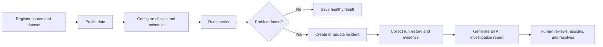

# DataSentinel

DataSentinel is a data-quality and pipeline-reliability platform. It checks whether important datasets are fresh, complete, valid, and believable; records evidence when a check fails; and helps a person investigate and resolve the issue.

## Product promise

DataSentinel should catch a bad-data condition before it silently reaches a report or customer. It must show what it observed, which rule failed, what evidence supports the incident, and what a human can check next. AI may summarize evidence and suggest actions; it must never silently change monitored production data.

## Agreed technology direction

- **Web:** React + TypeScript
- **API:** Node.js + NestJS + TypeScript
- **Application database:** PostgreSQL, accessed through Prisma
- **Background work:** Redis + BullMQ workers
- **File and document storage:** S3-compatible object storage; MinIO for local development is a suitable option
- **Data inputs:** CSV uploads, read-only PostgreSQL connections, registered API checks, and pipeline-run events
- **AI:** provider-independent LLM adapter; send minimized, redacted evidence only
- **Design:** Bauhaus-inspired, grid-based interface with functional geometry, strong typography, and a restrained primary-color palette

This is the intended full product, delivered in small, reviewable slices. It is not a reduced MVP scope. The reason for ordering work into phases is to build and understand each dependency before the next one.

## Start here

1. Read [the product specification](docs/01-product-specification.md).
2. Check the system boundaries in [the architecture](docs/02-architecture.md).
3. Review [the data model](docs/03-data-model.md) and [API contract](docs/04-api-contract.md) before implementing backend modules.
4. Follow [the small-step build roadmap](docs/07-build-roadmap.md) one checkbox at a time.
5. Use [the design system](docs/06-design-system.md) when implementing screens and [the operations guide](docs/08-quality-and-operations.md) before release.

## Local setup

Prerequisites: Git, and a Node version manager that reads `.nvmrc` ([fnm](https://github.com/Schniz/fnm) is used on Windows: `winget install Schniz.fnm`).

1. Configure fnm to switch versions on `cd` by adding this line to your PowerShell profile (`$PROFILE`):

   ```powershell
   fnm env --use-on-cd --shell powershell | Out-String | Invoke-Expression
   ```

   For Git Bash, add `eval "$(fnm env --use-on-cd --shell bash)"` to `~/.bashrc`.

2. In the repository, install the pinned Node version and check it:

   ```powershell
   fnm install
   node -v   # v26.x
   ```

3. Install pnpm. Node 26 does not bundle Corepack, so install it with npm; the `packageManager` field then makes pnpm switch to the exact pinned version (see [D-12](docs/09-decision-log.md)):

   ```powershell
   npm install -g pnpm
   ```

4. Install workspace dependencies. A wrong Node version fails here on purpose (`engineStrict`):

   ```powershell
   pnpm install
   ```

5. Create your local environment file and fill in the empty secrets, following the comments in it:

   ```powershell
   Copy-Item .env.example .env
   ```

Backing services (PostgreSQL, Redis, MinIO), migrations, seed data, and app start commands are added to this section as the roadmap reaches them.

## The main workflow



## Documentation map

| Document                                                    | What it defines                                                               |
| ----------------------------------------------------------- | ----------------------------------------------------------------------------- |
| [Product specification](docs/01-product-specification.md)   | Users, product scope, functional requirements, states, acceptance criteria    |
| [Architecture](docs/02-architecture.md)                     | Services, boundaries, data flow, queues, integrations, and repository shape   |
| [Data model](docs/03-data-model.md)                         | Main entities, relationships, tenancy, retention, and invariants              |
| [API contract](docs/04-api-contract.md)                     | REST conventions, endpoint groups, authorization, and error behavior          |
| [Security and privacy](docs/05-security-and-privacy.md)     | Threat boundaries, credentials, monitored data, AI, and audit controls        |
| [Bauhaus design system](docs/06-design-system.md)           | Visual rules, components, screens, responsive behavior, and accessibility     |
| [Build roadmap](docs/07-build-roadmap.md)                   | Small, ordered implementation steps and how to work with Claude Code plugins  |
| [Quality and operations](docs/08-quality-and-operations.md) | Definition of done, verification strategy, deployment, recovery, and runbooks |

## Important product boundary

The first release may include approved retries and validation reruns, but only through explicit approval, permission checks, and an audit record. Direct updates or deletes to a monitored production source are outside DataSentinel's authority.
