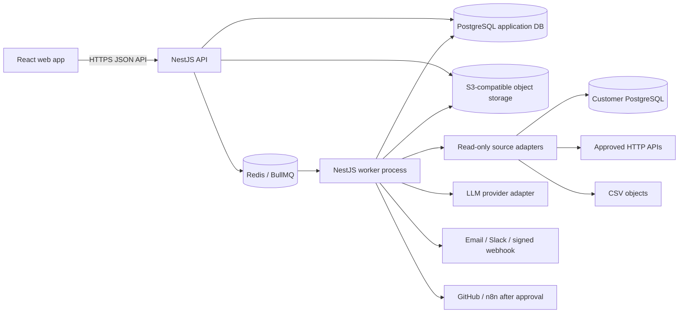

# DataSentinel Architecture

## 1. Architecture goals

- Use a TypeScript-first Node.js stack that is learnable and maintainable.
- Keep the first deployment a modular monolith with separately runnable API and worker processes; avoid premature microservices.
- Keep customer data access read-only and bounded.
- Make background work durable, retryable, observable, and idempotent.
- Preserve evidence for each check and incident so a result can be explained later.
- Isolate AI and external integrations behind adapters so they can be disabled or replaced.

## 2. High-level topology



## 3. Runtime components

### Web application

React + TypeScript single-page app. It renders dashboards, source and dataset forms, rule builders, history, incidents, integration settings, and administration. It calls the API; it does not connect directly to PostgreSQL, Redis, the object store, or LLM providers.

### API

NestJS modules expose versioned REST endpoints, validate input, authenticate users, enforce workspace and role permissions, write application records, and enqueue work. The API should return quickly for long-running jobs and expose their status by ID.

### Worker

The same codebase runs a separate NestJS worker process consuming BullMQ queues. Separate processes let API traffic and data-check work scale or restart independently. Worker jobs must be idempotent, bounded, retry-aware, and tenant-scoped.

### Application PostgreSQL

Stores users, workspaces, source metadata, encrypted-secret references, datasets, schemas, rules, runs, evidence, incidents, report metadata, integrations, approvals, and audit records. It is the product's source of truth. Use Prisma migrations and transactions for schema changes and multi-record state transitions.

### Redis and BullMQ

Carries scheduled and event-triggered jobs. Use separate named queues or job types for checks/profiling, notifications, document indexing, AI investigations, and approved actions. Configure attempts, exponential backoff, concurrency, lock duration, and retention deliberately. A failed queue job must not silently mark a check as passed.

### Object storage

Stores uploaded CSV objects and optionally source documents/exports. Keep object IDs and metadata in PostgreSQL. Use private buckets, short-lived upload/download URLs, encryption, content-length limits, and retention/deletion workflows. MinIO is for local development; production storage is an S3-compatible service selected before deployment.

## 4. Suggested code organization

```text
apps/
  web/                         React + TypeScript
  api/                         NestJS HTTP application
  worker/                      NestJS BullMQ worker entry point
packages/
  contracts/                   Shared DTO schemas and API types
  config/                       Environment parsing and shared config
  eslint-config/                Shared lint rules (if using a monorepo)
prisma/
  schema.prisma
  migrations/
docs/
  ...                          Product and engineering documentation
```

The exact workspace tool can be selected during repository setup. Keep the web app, API, worker, shared contracts, and Prisma schema in one repository until independent deployment or team ownership creates a real reason to split them.

Suggested NestJS domain modules:

```text
auth, users, workspaces, memberships, sources, datasets, profiles,
rules, checks, pipelines, incidents, evidence, notifications,
integrations, documents, investigations, actions, audit, health
```

Do not build a single giant service class. Modules own their validation, business rules, persistence operations, and events; shared infrastructure is injected through narrow interfaces.

## 5. Core data flows

### CSV upload

1. The API authorizes a user and creates a pending upload record.
2. The browser receives a short-lived, size-limited upload URL or streams through the API if direct uploads are not supported in the current environment.
3. The API verifies final object metadata and queues a profile job.
4. A worker streams and parses the CSV with encoding, delimiter, row-size, and total-size limits.
5. The worker writes schema/profile snapshots and check evidence; it does not execute formulas or macros.
6. The object is retained or deleted according to the workspace retention policy.

### PostgreSQL source check

1. A user enters a connection string/fields; the API validates host/port/database policy and encrypts credentials before saving.
2. A connection-test job verifies TLS and permissions using a read-only principal.
3. A worker opens a short-lived connection from a controlled egress path, applies a statement timeout, and runs only generated, parameterized metadata/aggregate queries.
4. A profile/check result is committed to the application database; the external source is never written.
5. Connections close in `finally` paths and secret values are excluded from logs/errors.

### Check to incident

1. The scheduler/API enqueues a check with workspace, dataset, rule version, and idempotency key.
2. The worker marks it running, obtains a consistent safe profile/aggregate, evaluates the rule, and stores an immutable result.
3. A domain service applies severity and grouping policy; it creates or appends to an incident.
4. An outbox/event record schedules alerting and, if configured, AI investigation.
5. The UI reads the incident, linked runs, profile snapshots, and evidence through authorized API calls.

### AI investigation

1. The worker gathers a bounded evidence snapshot and authorized relevant documents.
2. A redaction layer removes secrets, direct identifiers, and unapproved row values.
3. The provider adapter receives a structured prompt and returns a validated JSON report.
4. The report is stored with evidence IDs, prompt/template version, provider/model identifier, generation time, and status.
5. The UI labels possible causes as hypotheses and links each statement to evidence.

### Approved action

1. An authorized engineer creates a proposal with a typed action, exact target, and payload preview.
2. A separate authorized person (or configured approval policy) approves the immutable payload; self-approval can be disabled or restricted.
3. The worker rechecks permission, approval, expiry, idempotency key, and payload hash before execution.
4. The worker records the outcome and emits an audit event. It cannot execute an arbitrary model-generated command.

## 6. Connectors and adapters

Define a connector interface for `validate`, `profile`, `runCheck`, and `close`. Implement PostgreSQL, CSV/object, and HTTP/API adapters independently. Normalize results into internal profile and evidence shapes. Connector-specific raw errors are converted to safe error codes and redacted messages.

For HTTP/API checks, allow only explicitly registered schemes, hosts, methods, and paths. Block loopback, private, link-local, metadata, and other internal addresses unless a future approved deployment design explicitly supports them. Revalidate DNS and redirects to prevent SSRF.

For pipeline-run events, provide a signed webhook or scoped API token, timestamps, replay window, idempotency key, and per-workspace rate limits. Do not accept a workspace ID as proof of authorization.

## 7. Scheduling and queue rules

- Persist schedule definitions and next-run metadata in PostgreSQL; enqueue due jobs from a scheduler process.
- Use a unique schedule occurrence key so overlapping scheduler ticks cannot double-enqueue a run.
- Pass IDs and small options in jobs, not credentials or raw datasets.
- Load secrets at execution time through the secret service.
- Use bounded concurrency per workspace and per source to avoid overloading customer systems.
- Retry transient network/service failures only. Do not retry invalid credentials, invalid rule definitions, or permission denials indefinitely.
- Record terminal failures and expose retry controls to authorized operators.
- Use an outbox or equivalent transaction-safe event pattern when database state and queue publication must remain consistent.

## 8. Deployment shape

Local development uses containers for PostgreSQL, Redis, and object storage, with web/API/worker run from the workspace. Production runs the web app behind HTTPS and deploys API, worker, database, Redis, and private object storage as managed or containerized services. Select a cloud/hosting provider only after region, secret management, networking, backup, and budget constraints are known.

Keep dev/staging/production resources separate. Production source egress should be controlled. Workers need only the outbound access required for configured sources, model provider, notification providers, and action integrations.

## 9. Architectural decisions to revisit later

| Decision | Current direction | Revisit when |
|---|---|---|
| Service architecture | Modular monolith, API and worker as separate processes | Scaling/team ownership justifies service boundaries |
| Database | PostgreSQL + Prisma | Measured capacity or specialized analytics needs require another store |
| Queue | Redis + BullMQ | Queue durability/scale requirements outgrow the chosen deployment |
| Historical anomaly detection | Transparent thresholds and rolling baselines | There is enough trustworthy history and a validated need for more advanced models |
| Document retrieval | PostgreSQL full text plus optional pgvector | Corpus size/latency requires a dedicated retrieval service |
| Hosting provider | Not selected | Region, budget, compliance, and operational support are known |

