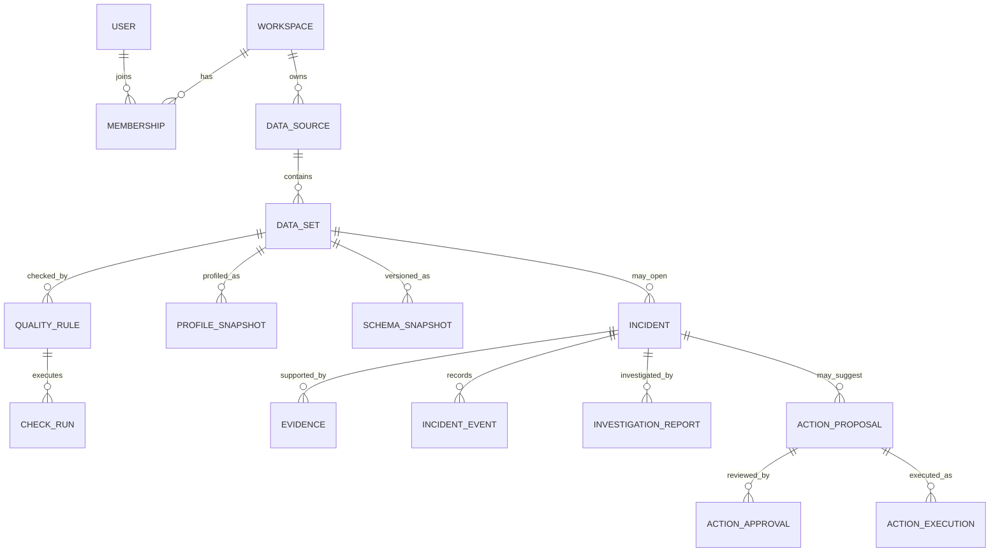

# DataSentinel Data Model

This document describes the logical model. Use Prisma migrations to implement physical tables. Field types below are conceptual; choose concrete Prisma/PostgreSQL types during implementation and keep migrations reviewable.

## 1. Model-wide rules

- Use UUID primary keys and UTC timestamps.
- Every workspace-owned record carries `workspaceId`, directly or through a parent relationship that is checked on every query.
- Use composite unique keys and foreign keys where needed so a record cannot reference a parent from another workspace.
- Store immutable execution results as append-only records. Mutable state belongs on lifecycle records such as incidents or integrations.
- Use database transactions for incident creation/grouping, approvals, and state changes that span multiple records.
- Store flexible rule definitions as versioned JSONB validated by application schemas. Do not store executable user SQL as the default rule format.
- Keep secrets out of normal model fields and Prisma query logs. Persist encrypted ciphertext plus key/version metadata in a restricted secret record or dedicated secret store.
- Soft-delete/archive operational configuration where audit/history must remain. Apply a separate retention job to data that has passed its retention period.

## 2. Identity and workspace tables

| Entity       | Important fields                                                                                                                | Relationships / constraints                                                                         |
| ------------ | ------------------------------------------------------------------------------------------------------------------------------- | --------------------------------------------------------------------------------------------------- |
| `User`       | `id`, normalized unique `email`, `passwordHash` or identity-provider subject, `displayName`, `status`, `createdAt`, `updatedAt` | Email uniqueness is case-insensitive; never store a raw password                                    |
| `Session`    | `id`, `userId`, hashed refresh/session token, expiry, last-used time, revoked time, safe device metadata                        | Many sessions per user; token hash unique; revoke on password reset or removal                      |
| `Workspace`  | `id`, `name`, slug, timezone, retention settings, created/updated time                                                          | Slug unique within product; timezone controls schedule display, while persisted timestamps stay UTC |
| `Membership` | `id`, `workspaceId`, `userId`, role, status, invited/accepted time                                                              | Unique `(workspaceId,userId)`; role is one of owner/admin/engineer/analyst/viewer                   |
| `Invitation` | `id`, `workspaceId`, normalized email, intended role, token hash, expiry, accepted/revoked time                                 | Token hash unique; invitation cannot grant a role above inviter's permission                        |

## 3. Source and dataset tables

| Entity             | Important fields                                                                                                                                                                | Relationships / constraints                                                                                         |
| ------------------ | ------------------------------------------------------------------------------------------------------------------------------------------------------------------------------- | ------------------------------------------------------------------------------------------------------------------- |
| `DataSource`       | `id`, `workspaceId`, name, type (`postgres`, `csv`, `http_api`, `pipeline_event`), owner membership, status, schedule settings, last checked time, created/updated/archive time | Unique display name may be enforced per workspace; credentials are referenced by ID, not returned inline            |
| `SourceCredential` | `id`, `workspaceId`, `sourceId`, encrypted payload or secret-store reference, encryption key version, rotated time, created/updated time                                        | One active credential per source/version; workspace and source must match; never serialize secret values to web/API |
| `DataSet`          | `id`, `workspaceId`, `sourceId`, stable key, name, description, owner, locator/table/path, status, schedule, sensitivity classification                                         | Unique `(workspaceId,sourceId,stableKey)`; database locator is validated and not arbitrary SQL                      |
| `Upload`           | `id`, `workspaceId`, `sourceId`, object key, original safe filename, size, checksum, content type, parse status, retention expiry                                               | Object key private; file metadata checked against uploaded content                                                  |
| `SchemaSnapshot`   | `id`, `workspaceId`, `datasetId`, observed time, schema hash, columns JSON, row count, profile run ID                                                                           | Immutable; index by `(datasetId,observedAt)`                                                                        |
| `ProfileSnapshot`  | `id`, `workspaceId`, `datasetId`, observed time, row count, last update time, metrics JSON, status, duration                                                                    | Immutable and linked to its source/check run; metrics identify exact/approximate method                             |

`SchemaSnapshot.columns` should contain stable column entries such as name, normalized type, nullable/required observation, ordinal position, and optional safe description. Do not put sample values in schema history by default.

## 4. Rules and execution tables

| Entity         | Important fields                                                                                                                                                                     | Relationships / constraints                                                                                                          |
| -------------- | ------------------------------------------------------------------------------------------------------------------------------------------------------------------------------------ | ------------------------------------------------------------------------------------------------------------------------------------ |
| `QualityRule`  | `id`, `workspaceId`, `datasetId`, name, rule type, version, validated definition JSON, severity, enabled, creator, timestamps                                                        | Each edit creates a version or immutable revision so a past result points to the exact rule definition                               |
| `RuleRevision` | `id`, `workspaceId`, `ruleId`, version, definition JSON, severity, created by/time                                                                                                   | Unique `(ruleId,version)`; immutable                                                                                                 |
| `Schedule`     | `id`, `workspaceId`, target type/ID, cron or interval definition, timezone, next run, enabled, concurrency policy                                                                    | Only approved schedule formats; validate minimum interval and timezone                                                               |
| `CheckRun`     | `id`, `workspaceId`, `datasetId`, `ruleId`, rule revision ID, trigger, status, expected JSON, actual JSON, started/ended time, duration, error code, correlation ID, idempotency key | Idempotency key unique within its target/workspace; immutable result after terminal state except safe annotations                    |
| `PipelineRun`  | `id`, `workspaceId`, optional source/dataset, external run ID, name, status, trigger, started/ended time, safe summary, correlation ID                                               | External ID unique per source when provided; event ingestion is idempotent                                                           |
| `Evidence`     | `id`, `workspaceId`, `incidentId`, kind, referenced record ID, observed time, safe summary JSON, source URI/reference                                                                | References existing same-workspace check, profile, schema, run, document chunk, or log summary; stores only minimal derived evidence |

Rule definition examples are conceptual and must be validated server-side:

```json
{
  "version": 1,
  "type": "not_null",
  "column": "customer_id",
  "maxNullPercent": 0
}
```

```json
{
  "version": 1,
  "type": "freshness",
  "timestampColumn": "updated_at",
  "maxAgeMinutes": 1440
}
```

```json
{
  "version": 1,
  "type": "row_count_change",
  "comparisonWindowDays": 7,
  "maxDropPercent": 30,
  "minimumHistoryPoints": 3
}
```

## 5. Incidents, collaboration, and alerting tables

| Entity                 | Important fields                                                                                                                                                    | Relationships / constraints                                                         |
| ---------------------- | ------------------------------------------------------------------------------------------------------------------------------------------------------------------- | ----------------------------------------------------------------------------------- |
| `Incident`             | `id`, `workspaceId`, `datasetId`, optional pipeline/source, dedupe key, title, severity, status, assigned membership, opened/updated/resolved time, resolution note | Dedupe key indexes grouping window; incident is not deleted when resolved           |
| `IncidentEvent`        | `id`, `workspaceId`, `incidentId`, actor, event type, old/new state, safe details JSON, timestamp                                                                   | Append-only status/assignment/severity history                                      |
| `IncidentComment`      | `id`, `workspaceId`, `incidentId`, author, text, created/edited time                                                                                                | Edits can preserve an audit event; sanitize rendered text                           |
| `InvestigationReport`  | `id`, `workspaceId`, `incidentId`, status, structured report JSON, evidence snapshot IDs, provider/model ID, template version, generated time, error code           | Versioned; a new report does not overwrite the previous report                      |
| `AlertDestination`     | `id`, `workspaceId`, type (`email`, `slack`, `webhook`), name, enabled, encrypted config reference, event filters                                                   | Secret config never returned; workspace owner/admin manage destinations             |
| `NotificationDelivery` | `id`, `workspaceId`, `incidentId`, destination ID, event ID, status, attempts, next retry, sent time, redacted error                                                | Idempotent on incident event + destination; no sensitive data in payload by default |

## 6. Documents, integrations, and approved actions

| Entity              | Important fields                                                                                                      | Relationships / constraints                                                    |
| ------------------- | --------------------------------------------------------------------------------------------------------------------- | ------------------------------------------------------------------------------ |
| `KnowledgeDocument` | `id`, `workspaceId`, name, source, object key or safe URL, owner, status, checksum, indexed time                      | Access is workspace-scoped; document removal also removes retrieval chunks     |
| `DocumentChunk`     | `id`, `workspaceId`, `documentId`, chunk index, text with redactions, section/title, content hash, optional embedding | Retrieval always filters by workspace and allowed document status              |
| `Integration`       | `id`, `workspaceId`, provider, enabled, encrypted credential reference, config JSON, created/updated time             | Credential rotation and permission scope are audited                           |
| `ActionProposal`    | `id`, `workspaceId`, `incidentId`, action type, typed payload, payload hash, status, requested by/time, expires time  | Payload schema is action-specific; no free-form executable command             |
| `ActionApproval`    | `id`, `workspaceId`, `proposalId`, approver, decision, payload hash, comment, decided time                            | Approval must match current proposal hash; enforce separation-of-duties policy |
| `ActionExecution`   | `id`, `workspaceId`, `proposalId`, idempotency key, status, started/ended time, safe output, error code               | One execution per approved idempotency key; retries require explicit policy    |

## 7. Audit and reliability tables

| Entity              | Important fields                                                                                                                               | Relationships / constraints                                                                 |
| ------------------- | ---------------------------------------------------------------------------------------------------------------------------------------------- | ------------------------------------------------------------------------------------------- |
| `AuditEvent`        | `id`, `workspaceId`, actor type/ID, action, target type/ID, request ID, redacted before/after summary, IP/device metadata if needed, timestamp | Append-only; do not store passwords, full tokens, connection strings, or raw sensitive rows |
| `OutboxEvent`       | `id`, `workspaceId`, event type, aggregate ID, payload, created/published time, attempts                                                       | Supports reliable publish-after-commit; payload contains references, not secrets            |
| `IdempotencyRecord` | `id`, workspace, principal, route/action, idempotency key, request hash, response/resource reference, expiry                                   | Same key + different request hash returns conflict                                          |

## 8. Relationship overview



## 9. Retention guidance

Make retention configurable by workspace and record class. Keep audit and incident history longer than uploaded raw files. Expire CSV objects and source-document objects on a documented policy; remove their derived chunks when documents are deleted. Keep profile/check history only as long as the product needs for baselines and customer policy permits. Deletion jobs must be observable, idempotent, and leave a minimal audit tombstone when appropriate.
